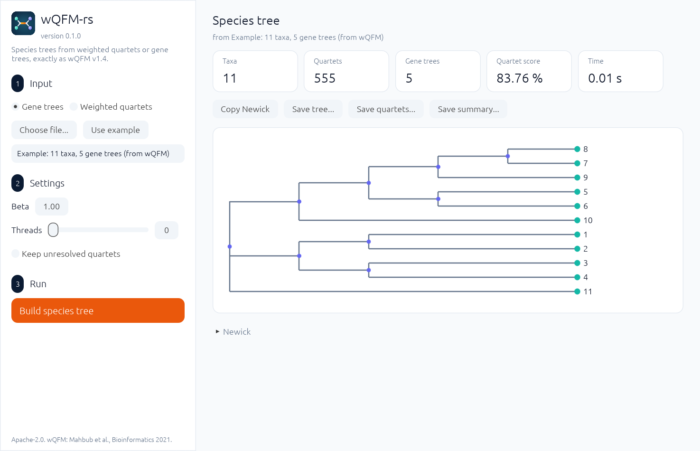

<p align="center">
  
</p>

<h1 align="center">wQFM-rs</h1>

<p align="center">Exact, fast weighted quartet amalgamation for species trees, in Rust</p>

An exact Rust implementation of **wQFM**, the weighted quartet amalgamation
method of Mahbub, Wahab, Reaz, Rahman and Bayzid (*Bioinformatics*
37:3734–3743, 2021). It follows the official Java code (version 1.4) rule by
rule, including its tie-breaking, so it returns the same tree and score.

## Install

From source (Rust 1.98 or later):

```bash
cargo build --release
```

The binary is `target/release/wqfm-rs`. After the first release, binaries
for Linux, Windows and macOS are attached to each GitHub release, and
`cargo install wqfm-rs` and a Bioconda package follow (`docs/RELEASING.md`).
A container: `docker build -t wqfm-rs .`

## Use

Input is wQFM's format: one weighted quartet per line.

```text
((a,b),(c,d)); 0.75
((a,c),(b,e)); 0.20
```

```bash
wqfm-rs gt2wq -i genetrees.nwk -o quartets.txt
wqfm-rs amalgamate -i quartets.txt -o tree.nwk
wqfm-rs score -i quartets.txt -t tree.nwk
wqfm-rs compare a.nwk b.nwk
```

Results go to the output file or standard output; a short summary (and a
progress bar for long `gt2wq` runs) goes to standard error, in colour on a
terminal. `-q` turns the summary off.

`gt2wq` turns gene trees (one Newick per line) into weighted quartets,
byte for byte as wQFM's `generate_wqrts.py` does, except that 4-sets a gene tree
does not resolve are left out (the wQFM jar cannot read the script's lines
for them; `--keep-unresolved` writes them anyway, see `docs/decisions.md`), and
`-t` sets the number of threads. `amalgamate` takes `--beta` (default 1), the weight of violated quartets in
the partition score. `score` prints the satisfied weight, the total weight and
their ratio.

## Desktop app

`wqfm-rs-gui` does the same in a window: choose or drop a file of gene trees or
weighted quartets (or use the built-in example), keep or change the settings
(every control explains itself on hover), press **Build species tree**, then
view the tree, copy its Newick, or save the tree, the quartets and a summary.

<p align="center"></p>

```bash
cargo run --release -p wqfm-gui
```

## Library

```rust
use wqfm::{amalgamate, Options, Quartet};
let names: Vec<String> = ["a", "b", "c", "d"].map(String::from).to_vec();
let tree = amalgamate(&names, &[Quartet::new(0, 1, 2, 3, 1.0)], &Options::default());
println!("{}", tree.newick);
```

## Layout

| Path | Contents |
|---|---|
| `crates/wqfm` | the library, one feature per file |
| `crates/wqfm-cli` | the `wqfm-rs` command |
| `crates/wqfm-gui` | the desktop app `wqfm-rs-gui` |
| `docs/USAGE.md` | manual: worked example, options, input rules, messages |
| `docs/decisions.md` | design decisions |
| `validation/` | comparison records with the wQFM jar |
| `scripts/jar_compare.sh` | runs the jar comparison |
| `bench/PREREGISTRATION.md` | the benchmark plan, fixed before any run |
| `packaging/` | Bioconda recipe draft |

## Licence

Apache-2.0. wQFM is © its authors under Apache-2.0; see `NOTICE`. No Java
code is included.
